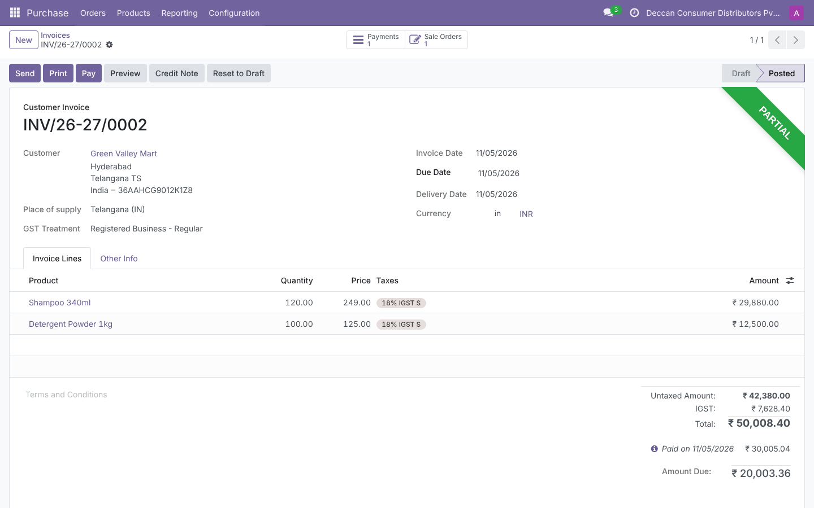
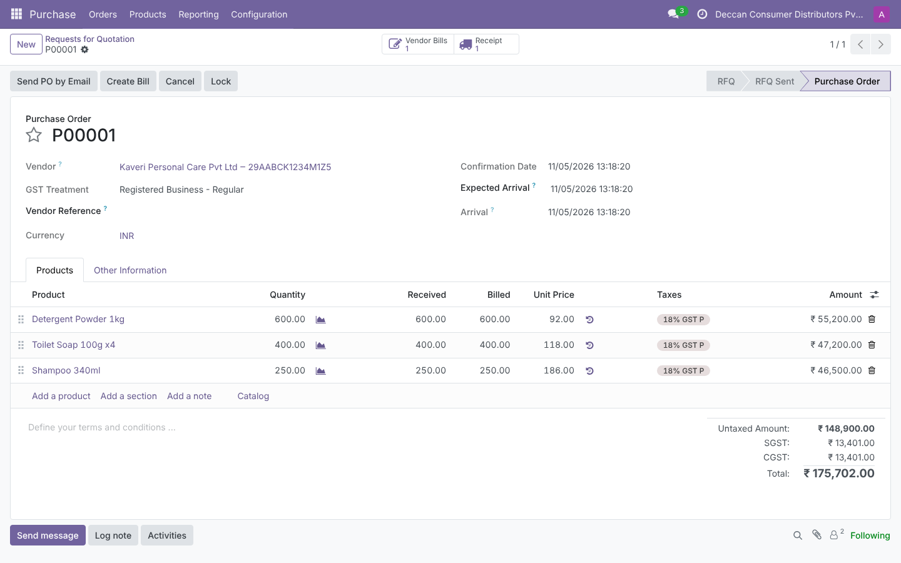
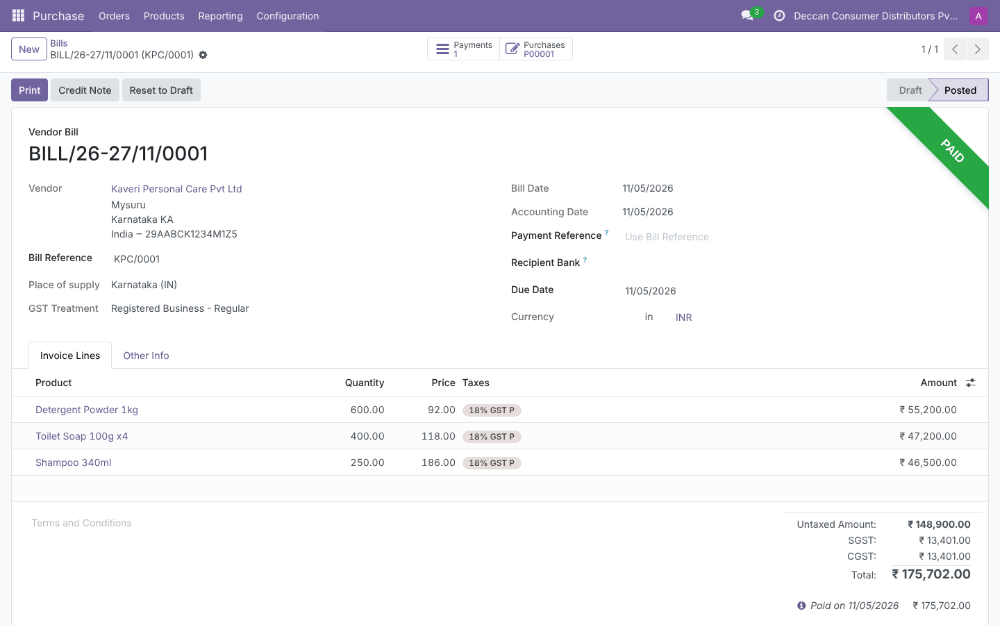
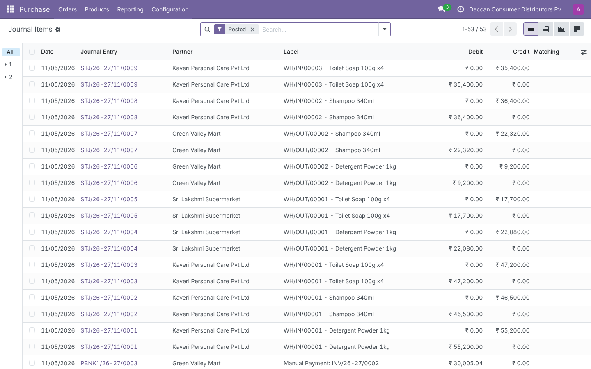

# ERP Procure-to-Pay and Order-to-Cash Walkthrough (Odoo 18)

End-to-end purchase and sales cycles run in a real ERP, Odoo 18 Community with the Indian localization, documenting the accounting entry behind every step and extracting the posted data with SQL into a finance data warehouse.



## What it covers

- **Procure-to-pay:** RFQ, purchase order, goods receipt, vendor bill with three-way match, vendor payment.
- **Order-to-cash:** quotation, sales order, delivery, customer invoice, full and partial receipts.
- **Accounting behind each step:** perpetual inventory with interim clearing accounts, cost of goods sold matched to revenue, input and output GST, and payables and receivables control accounts.
- **GST treatment:** CGST and SGST on intra-state transactions (Karnataka to Karnataka), IGST on inter-state transactions (Karnataka to Telangana), applied automatically by Odoo's fiscal positions.
- **SQL extraction:** queries against Odoo's PostgreSQL tables for the GL, invoices, and settlements, mapped onto a warehouse chart of accounts and loaded into [finance-data-warehouse](https://github.com/And3m/finance-data-warehouse), where the AR and AP subledgers are reconciled to the GL.
- **Business analysis reports in SQL:** trial balance, three-way match status, goods received not billed, and customer open items.

## The scenario

Deccan Consumer Distributors Pvt Ltd (fictional, Bengaluru) buys packaged goods from a Karnataka supplier and sells to two retailers:

| Cycle | What happens | Left open |
|---|---|---|
| OPEN | Owners introduce 5,00,000 of share capital | |
| P2P-1 | 600 detergent, 400 soap, 250 shampoo ordered, received, billed, and paid | |
| O2C-1 | Sale to Sri Lakshmi Supermarket, Bengaluru (CGST + SGST), paid in full | |
| O2C-2 | Sale to Green Valley Mart, Hyderabad (IGST), 60% paid | 20,003.36 receivable |
| P2P-2 | 200 shampoo received and billed, not yet paid | 42,952.00 payable |
| P2P-3 | 300 soap received, bill not yet received | 35,400.00 goods received not billed |

Every step is driven through Odoo's standard external API, the same actions a user takes on screen: confirm, validate the transfer, create and post the invoice, register the payment.

## Accounting entries, step by step

| Step | Debit | Credit | Why |
|---|---|---|---|
| Confirm PO or SO | none | none | A commitment, not a transaction |
| Goods receipt | Inventories | Stock Interim (Received) | Stock valued at PO cost the moment it arrives |
| Vendor bill | Stock Interim (Received), CGST and SGST Receivable | Creditors | Clears the interim account and books the payable and input tax credit |
| Vendor payment | Creditors | Outstanding Payments | Settles the payable; clears to Bank on statement reconciliation |
| Delivery | Stock Interim (Delivered) | Inventories | Stock leaves at average cost |
| Customer invoice | Debtors; Cost of Goods Sold | Local Sales, CGST/SGST or IGST Payable; Stock Interim (Delivered) | Revenue, output tax, and the matching cost recognised together |
| Customer receipt | Outstanding Receipts | Debtors | Reduces the receivable; a short payment stays open |

The full set of entries Odoo actually posted, with amounts, is in [`docs/journal_entries.md`](docs/journal_entries.md), generated from the live database.

Two controls fall out of this design. The Stock Interim (Received) balance always equals goods received not billed, which is the month-end accrual. Stock Interim (Delivered) returns to zero once every delivery is invoiced. In this run the first is a 35,400 credit, matching the GRNI report to the rupee, and the second is zero.

## SQL extraction and the warehouse

```
Odoo PostgreSQL ──SQL──> warehouse source files ──ETL──> finance warehouse (star schema)
   account_move_line          gl_journal_lines.csv            fact_gl
   account_move               ar_invoices / ap_invoices       fact_ar_invoice / fact_ap_invoice
   account_partial_reconcile  ar_receipts / ap_payments       reconciled to GL control accounts
```

- [`sql/extract_gl_lines.sql`](sql/extract_gl_lines.sql) reads posted journal lines. Odoo 18 stores account codes per company in a jsonb column (`code_store`), so the query keys it by company.
- [`sql/extract_invoices.sql`](sql/extract_invoices.sql) and [`sql/extract_settlements.sql`](sql/extract_settlements.sql) build the AR and AP subledgers from invoices and Odoo's reconciliation table.
- [`sql/account_mapping.csv`](sql/account_mapping.csv) maps the 17 Odoo accounts in use onto the warehouse chart (for example, Debtors 100400 to Accounts Receivable 1100, and the CGST, SGST, and IGST accounts to the GST accounts). Any unmapped account is passed through under its Odoo code, so the warehouse check `gl_accounts_exist_in_chart` stops the load and names it.

Result of the warehouse load in this run: all data quality checks pass, the trial balance nets to zero, AR ties to the GL at 20,003.36, and AP ties at 42,952.00.

## Business analysis reports

Run with `python scripts/run_reports.py`, saved to `output/reports/`.

| Query | Answers |
|---|---|
| [`trial_balance.sql`](sql/reports/trial_balance.sql) | Debits, credits, and balance for every account |
| [`three_way_match.sql`](sql/reports/three_way_match.sql) | Ordered vs received vs billed quantity and price per PO line: Matched, Quantity mismatch, Price mismatch, or Awaiting bill |
| [`goods_received_not_billed.sql`](sql/reports/goods_received_not_billed.sql) | Receipts with no bill yet, and the value to accrue |
| [`ar_open_items.sql`](sql/reports/ar_open_items.sql) | Unpaid and part-paid customer invoices with days past due |

## Screenshots

| | |
|---|---|
|  |  |
| Purchase order P00001 | Vendor bill with CGST and SGST |
|  |  |
| Inter-state invoice with IGST, partly paid | Posted journal items |

## Run it yourself

Requirements: Python 3.10 or later, PostgreSQL, and the Odoo 18 source.

```bash
git clone --depth 1 -b 18.0 https://github.com/odoo/odoo.git odoo-src
python -m venv venv && venv/bin/pip install -r odoo-src/requirements.txt
pip install -r requirements.txt

# create the database: Indian company, chart of accounts with GST, Accounting, Purchase, Sales, Inventory
scripts/setup_odoo_db.sh odoo-src/odoo-bin odoo.conf erp_demo

# start Odoo, then in another terminal:
venv/bin/python odoo-src/odoo-bin -c odoo.conf -d erp_demo
python scripts/run_walkthrough.py --url http://localhost:8069 --db erp_demo --user admin --password admin
python scripts/extract_to_warehouse.py --dsn "host=localhost dbname=erp_demo user=odoo password=odoo" \
    --warehouse ../finance-data-warehouse
python scripts/run_reports.py
```

A sample `odoo.conf` is included. The walkthrough expects a fresh database, since it creates its own products, partners, and accounting setup.

## Project layout

```
scripts/setup_odoo_db.sh         create and configure the Odoo database
scripts/run_walkthrough.py       run the P2P and O2C cycles through the Odoo API and record journal entries
scripts/extract_to_warehouse.py  SQL extraction, account mapping, warehouse load
scripts/run_reports.py           business analysis queries to CSV
sql/                             extraction queries, account mapping, report queries
docs/journal_entries.md          every journal entry posted, by step
docs/screenshots/                Odoo screens from the run
output/                          extracts, reports, and the step log from the run
```

## Possible extensions

Bank statement import and reconciliation (moving Outstanding Receipts and Payments to Bank), a credit note and a purchase return, a price variance on the vendor bill to exercise the three-way match exception path, and a GSTR-1 style outward supplies summary.
